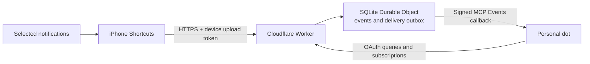

# DotLink

[English](README.md) | [简体中文](README.zh-CN.md)

Send selected iPhone notifications to your own ChatGPT dot using iOS Shortcuts and a self-hosted Cloudflare bridge.

**DotLink v0.1.0 — Notifications.** The current installation path covers Notifications only. Charging, Focus On and Focus Off are **Coming soon**; their old release attachments are historical artifacts, not currently supported installation options. The owner reported successful Notifications setup on 2026-10-20; this does not establish all-app coverage or long-term reliability. See the [validation record](docs/validation-record.md). DotLink is source-available under PolyForm Noncommercial 1.0.0 and requires your own accounts and manual phone configuration.

DotLink is for one owner and their registered devices. Historical phone testing used iOS 27 and selected sources. It is not affiliated with or endorsed by Apple, Cloudflare, GitHub, or OpenAI.

## Download templates

| Module | Status |
| --- | --- |
| Notifications | [Download DotLink-Notifications.shortcut](https://github.com/zzaachaary/dotlink/releases/download/v0.1.0/DotLink-Notifications.shortcut) |
| Charging | Coming soon |
| Focus On / Focus Off | Coming soon |

[SHA-256 checksums](https://github.com/zzaachaary/dotlink/releases/download/v0.1.0/SHA256SUMS) · [Notification import instructions](docs/iphone-shortcuts.md). The checksum file also retains historical assets; it does not make them current installation options. Configure your own URL/token and one permitted notification source before enabling Automation.

## Capabilities and limits

| Capability | Current evidence and limits |
| --- | --- |
| Selected app notifications | Some WeChat, Douyin, phone, and mail notifications reached the original personal dot in historical testing. Only fields actually supplied by iOS can be forwarded. |
| Charging | Coming soon; historical tests do not establish current support. |
| Focus On / Focus Off | Coming soon; historical tests do not establish current support. |
| Query and push | OAuth-protected MCP tools, event subscriptions, signed callbacks, and bounded server retries. |
| Offline and recovery | No persistent phone outbox; failed phone uploads may be lost. No cursor replay. Real cross-day renewal remains unverified. |
| Coverage | No all-app guarantee, automatic enrollment of future apps, historical chat access, or full SMS/iMessage/attachment guarantee. |

Historical results were recorded through 2026-10-01 and documented on 2026-10-02. They are not a complete retest of the current source and four templates. See [verification](docs/verification.md) and the [validation record](docs/validation-record.md).

## Install on your own accounts

You need an iPhone that actually provides the required Notification Shortcuts trigger, your own Cloudflare and GitHub accounts, and a ChatGPT dot account that can connect to custom MCP services and subscribe to MCP Events. An ordinary model API or a client that only calls MCP tools is not equivalent.

Complete one installation in this order. Continue after each step passes; troubleshoot only the step that fails:

1. Use [Deploy to Cloudflare](https://deploy.workers.cloudflare.com/?url=https%3A%2F%2Fgithub.com%2Fzzaachaary%2Fdotlink) to create a separate Worker in your own Cloudflare account, initially without variables or Secrets.
2. Open the new Worker's `/setup`, select a language, create your GitHub OAuth App, and privately save your generated device credentials and sealing key.
3. Apply the **3 variables and 4 Secrets** in the [deployment guide](docs/deployment.md). Keep `ENABLE_INGEST=false` and require `/health` to return `200`.
4. Import **DotLink-Notifications**. Save your full HTTPS `/ingest` URL and raw device token without `Bearer` or whitespace. Keep Automation off while selecting one allowed source and binding its App/Title/Body fields; exclude ChatGPT, Codex and Shortcuts.
5. Connect the target dot to `/mcp` through OAuth. Copy the [Step 6 prompt](docs/deployment.md#6-connect-your-dot-and-verify-notifications) into your receiving chat to establish a `phone.event` subscription for `iphone-primary` and `notification`.
6. Once the subscription is confirmed, enable server ingestion and the configured notification automation. Generate harmless new notifications from the selected source and confirm up to three distinct new-event acknowledgements. The subscription remains active after those test replies.

Cloudflare Hosted Deploy, fresh resource creation and `/setup` generation from the same first-edition source lineage passed on 2026-10-15. Owner OAuth, dot connection and phone triggers were not all completed on that new installation. A different isolated instance has real OAuth, subscription, synthetic-event and one manual iPhone Charging success; those results cannot be combined into a complete new-installation pass.

Use the default `workers.dev` address; buying a domain is not required. Neither that address nor a custom domain guarantees mainland-China reachability or changes platform availability. Cloudflare and ChatGPT usage may incur costs; no free-service or uptime guarantee is made.

Read the [deployment guide](docs/deployment.md) for the browser flow and the retained CLI recovery path. `/setup` is for a **fresh deployment**; do not replace an existing `BRIDGE_SEAL_KEY` or `DEVICE_REGISTRY` with newly generated values.

## Architecture



The phone collects explicitly selected events. The bridge authenticates, validates, persists, and delivers them. GitHub verifies the owner during connection; it does not transport notification bodies. Daily phone uploads do not require a Mac or iPhone Mirroring to remain open.

An upload `202` proves bridge persistence. A callback `2xx` proves receiver acknowledgement. A matching dot response proves processing of that particular event. These are separate checkpoints.

## Documentation

| Topic | Guide |
| --- | --- |
| Browser setup and advanced deployment | [Deployment](docs/deployment.md) |
| Notification installation and troubleshooting | [iPhone Shortcuts](docs/iphone-shortcuts.md) |
| Data flow and permissions | [Architecture](docs/architecture.md) |
| First implementation and historical limits | [First version](docs/first-version.md) |
| Identity, networks, renewal, and service delivery | [FAQ](docs/faq.md) |
| JSON, tools, quotas, and expiry | [Protocol](docs/protocol.md) |
| Acceptance and troubleshooting | [Verification](docs/verification.md) · [Validation record](docs/validation-record.md) |
| Upcoming work | [Roadmap](docs/roadmap.md) |
| Privacy and contribution | [Security](SECURITY.md) · [Contributing](CONTRIBUTING.md) |

`src/` contains the Worker; `scripts/` contains local configuration helpers; `test/` uses synthetic data; `examples/` contains no credentials. Keep local configuration, `work/`, `.wrangler/`, databases, screenshots, real events, and personalized shortcut exports out of the public repository. Do not upload the whole working directory.

For local development, use Node.js 24 and the existing npm lockfile. Dependency installation contacts npm; tests do not send events to a real dot:

```sh
npm ci --ignore-scripts --no-audit --no-fund
npm test
npm run test:runtime
```

## License

Original code and documentation are provided under the [PolyForm Noncommercial License 1.0.0](LICENSE). Commercial uses outside its grant require separate permission from the relevant rights holders; the original license text governs. The original [required copyright notice](NOTICE) is retained.

Dependencies keep their own licenses, listed in [Third-party notices](THIRD_PARTY_NOTICES.md). This license grants no platform accounts, personal data, trademarks, or third-party service rights.
