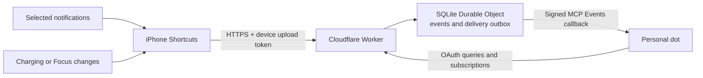

# DotLink

[English](README.md) | [简体中文](README.zh-CN.md)

Send selected iPhone notifications, charging changes, and Focus changes to your own ChatGPT dot using iOS Shortcuts and a self-hosted Cloudflare bridge.

**Experimental Beta `0.1.0-beta.1`.** Download the four sanitized Apple-signed templates from the [first Beta release](https://github.com/zzaachaary/dotlink/releases/tag/v0.1.0-beta.1). Charging has completed one real iPhone → Bridge → dot round. The notification and Focus templates follow the existing personal bridge’s event contract; remaining device checks are disclosed in the [validation record](docs/validation-record.md). This is self-hosted, source-available software under PolyForm Noncommercial 1.0.0. Setup requires your own accounts and manual phone configuration.

DotLink is for one owner and their registered devices. Historical phone testing used iOS 27 and selected sources. It is not affiliated with or endorsed by Apple, Cloudflare, GitHub, or OpenAI.

## Download templates

| Module | Signed shortcut |
| --- | --- |
| Notifications | [DotLink-Notifications.shortcut](https://github.com/zzaachaary/dotlink/releases/download/v0.1.0-beta.1/DotLink-Notifications.shortcut) |
| Charging | [DotLink-Charging.shortcut](https://github.com/zzaachaary/dotlink/releases/download/v0.1.0-beta.1/DotLink-Charging.shortcut) |
| Focus on | [DotLink-Focus-On.shortcut](https://github.com/zzaachaary/dotlink/releases/download/v0.1.0-beta.1/DotLink-Focus-On.shortcut) |
| Focus off | [DotLink-Focus-Off.shortcut](https://github.com/zzaachaary/dotlink/releases/download/v0.1.0-beta.1/DotLink-Focus-Off.shortcut) |

[SHA-256 checksums](https://github.com/zzaachaary/dotlink/releases/download/v0.1.0-beta.1/SHA256SUMS) · [Import instructions](docs/iphone-shortcuts.md). Configure your own URL/token and bind the phone triggers before enabling Automation.

## Capabilities and limits

| Capability | Current evidence and limits |
| --- | --- |
| Selected app notifications | Some WeChat, Douyin, phone, and mail notifications reached the original personal dot in historical testing. Only fields actually supplied by iOS can be forwarded. |
| Charging and battery | Lock-screen charger connection/disconnection reported measured battery and charging state. This is not continuous battery monitoring. |
| Focus | Three selected modes were historically tested in both directions. Reports name, state, and time; does not control the phone. |
| Query and push | OAuth-protected MCP tools, event subscriptions, signed callbacks, and bounded server retries. |
| Other protocol fields | Location, connection, app activity, low-power mode, and health support in the protocol does not mean an iPhone collector is enabled or verified. |
| Offline and recovery | No persistent phone outbox; failed phone uploads may be lost. No cursor replay. Real cross-day renewal remains unverified. |
| Coverage | No all-app guarantee, automatic enrollment of future apps, historical chat access, or full SMS/iMessage/attachment guarantee. |

Historical results were recorded through 2026-10-01 and documented on 2026-10-02. They are not a retest of this release candidate. See [verification](docs/verification.md) and the [validation record](docs/validation-record.md).

## Install on your own accounts

You need an iPhone with the required iOS 27 Shortcuts triggers, your own Cloudflare and GitHub accounts, and a ChatGPT dot account that can connect to custom MCP services and subscribe to MCP Events. An ordinary model API or a client that only calls MCP tools is not equivalent.

The Beta setup path is browser-first:

1. Deploy a separate Worker to **your own Cloudflare account** with the official Deploy to Cloudflare flow.
2. Open your Worker's `/setup`, choose English or 简体中文, and follow its guide. It generates fresh device credentials and a sealing key locally in your browser using Web Crypto.
3. Enter the displayed variables and Secrets yourself in the Cloudflare dashboard, and create your own GitHub OAuth App. The guide does not receive a Cloudflare API token or GitHub Client Secret.
4. Connect your own dot to `/mcp`, complete owner authorization, and establish a `phone.event` subscription.
5. Choose any of the three independent modules: notifications, charging, or Focus. Download the [signed templates](https://github.com/zzaachaary/dotlink/releases/tag/v0.1.0-beta.1), then follow the [phone import and trigger setup](docs/iphone-shortcuts.md).
6. Enable upload only after configuration, then verify a harmless synthetic event and the real triggers you selected, including the target dot's response.

[Deploy to Cloudflare](https://deploy.workers.cloudflare.com/?url=https%3A%2F%2Fgithub.com%2Fzzaachaary%2Fdotlink) starts from this repository. The public button and a fresh-account installation remain follow-up checks for this experimental Beta; the existing personal deployment is not evidence that every fresh installation works.

Use the default `workers.dev` address; buying a domain is not required. Neither that address nor a custom domain guarantees mainland-China reachability or changes platform availability. Cloudflare and ChatGPT usage may incur costs; no free-service or uptime guarantee is made.

Read the [deployment guide](docs/deployment.md) for the browser flow and the retained CLI recovery path. `/setup` is for a **fresh deployment**; do not replace an existing `BRIDGE_SEAL_KEY` or `DEVICE_REGISTRY` with newly generated values.

## Architecture



The phone collects explicitly selected events. The bridge authenticates, validates, persists, and delivers them. GitHub verifies the owner during connection; it does not transport notification bodies. Daily phone uploads do not require a Mac or iPhone Mirroring to remain open.

An upload `202` proves bridge persistence. A callback `2xx` proves receiver acknowledgement. A matching dot response proves processing of that particular event. These are separate checkpoints.

## Documentation

| Topic | Guide |
| --- | --- |
| Browser setup and advanced deployment | [Deployment](docs/deployment.md) |
| Optional phone modules and manual recovery | [iPhone Shortcuts](docs/iphone-shortcuts.md) |
| Data flow and permissions | [Architecture](docs/architecture.md) |
| First implementation and historical limits | [First version](docs/first-version.md) |
| Identity, networks, renewal, and service delivery | [FAQ](docs/faq.md) |
| JSON, tools, quotas, and expiry | [Protocol](docs/protocol.md) |
| Acceptance and troubleshooting | [Verification](docs/verification.md) · [Validation record](docs/validation-record.md) |
| Upcoming work | [Roadmap](docs/roadmap.md) |
| Privacy and contribution | [Security](SECURITY.md) · [Contributing](CONTRIBUTING.md) |

`src/` contains the Worker; `scripts/` contains local configuration helpers; `test/` uses synthetic data; `examples/` contains no credentials. Keep local configuration, `work/`, `.wrangler/`, databases, screenshots, real events, and personalized shortcut exports out of the public repository. Do not upload the whole working directory.

For local development, use Node.js 24 and the existing npm lockfile. Dependency installation contacts npm; tests do not send events to a real dot:

```sh
npm ci --ignore-scripts --no-audit --no-fund
npm test
npm run test:runtime
```

## License

Original code and documentation are provided under the [PolyForm Noncommercial License 1.0.0](LICENSE). Commercial uses outside its grant require separate permission from the relevant rights holders; the original license text governs. The original [required copyright notice](NOTICE) is retained.

Dependencies keep their own licenses, listed in [Third-party notices](THIRD_PARTY_NOTICES.md). This license grants no platform accounts, personal data, trademarks, or third-party service rights.
