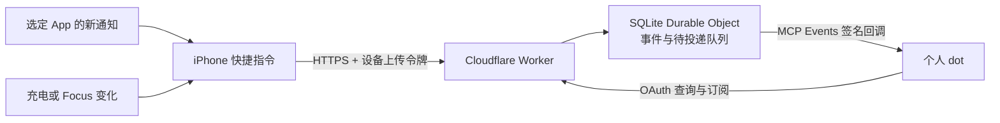

# DotLink

[English](README.md) | [简体中文](README.zh-CN.md)

通过 iPhone 系统快捷指令和自己部署的 Cloudflare Bridge，将选定 App 的新通知、充电变化与专注模式变化交给自己的 ChatGPT dot。

**DotLink v0.1.0 正式版。** [v0.1.0 Release](https://github.com/zzaachaary/dotlink/releases/tag/v0.1.0) 提供 Bridge、双语设置教程与四份脱敏 Apple 签名模板。模板沿用 `v0.1.0-beta.1` 的原始签名字节，本次发布没有新增真机验收结果。每个新安装及所选手机触发器仍需本人验收，尚不作稳定性保证。已通过与待验证的范围见[验证记录](docs/zh-CN/validation-record.md)。本项目采用 PolyForm Noncommercial 1.0.0，需要自己的账号和手工手机配置。

DotLink 面向一个所有者及其登记设备。历史手机测试使用 iOS 27，只覆盖选定来源。项目与 Apple、Cloudflare、GitHub、OpenAI 没有官方隶属或背书关系。

## 下载模板

| 模块 | 签名快捷指令 |
| --- | --- |
| 通知 | [DotLink-Notifications.shortcut](https://github.com/zzaachaary/dotlink/releases/download/v0.1.0/DotLink-Notifications.shortcut) |
| 充电 | [DotLink-Charging.shortcut](https://github.com/zzaachaary/dotlink/releases/download/v0.1.0/DotLink-Charging.shortcut) |
| 专注开启 | [DotLink-Focus-On.shortcut](https://github.com/zzaachaary/dotlink/releases/download/v0.1.0/DotLink-Focus-On.shortcut) |
| 专注关闭 | [DotLink-Focus-Off.shortcut](https://github.com/zzaachaary/dotlink/releases/download/v0.1.0/DotLink-Focus-Off.shortcut) |

[SHA-256 校验文件](https://github.com/zzaachaary/dotlink/releases/download/v0.1.0/SHA256SUMS) · [导入说明](docs/zh-CN/iphone-shortcuts.md)。填写自己的地址／令牌，绑定手机触发器之后再开启 Automation。

## 能力与边界

| 能力 | 当前证据与限制 |
| --- | --- |
| 选定 App 通知 | 历史测试中，部分微信、抖音、电话和邮件通知进入了原个人 dot；只传 iOS 实际提供的字段。 |
| 充电与电量 | 锁屏插入／拔出充电器时上报测得的电量和充电状态；不是连续电量监控。 |
| 专注模式 | 三个选定模式的开启／关闭曾通过历史验证；记录名称、状态和时间，不控制手机。 |
| 查询与推送 | OAuth 保护的 MCP 工具、事件订阅、签名回调及云端有限重试。 |
| 其他协议字段 | 位置、连接、App 活动、省电和健康字段存在，不代表 iPhone 已启用或验证对应采集。 |
| 离线与恢复 | 没有手机持久 outbox，上传失败可能漏事件；不支持游标重放；真实跨日续期仍待验证。 |
| 覆盖范围 | 不保证全部 App、未来新 App 自动加入、历史聊天读取，或完整 SMS／iMessage／附件采集。 |

历史真机结果截至 2026-10-01，整理于 2026-10-02，不是当前源码及四份模板的完整复测结果。详见[验证说明](docs/zh-CN/verification.md)和[验证记录](docs/zh-CN/validation-record.md)。

## 用自己的账号安装

需要具备所用 iOS 27 快捷指令触发器的 iPhone、自己的 Cloudflare 和 GitHub 账号，以及可以连接自定义 MCP 服务并订阅 MCP Events 的 ChatGPT dot 账号。普通模型 API 或只能调用 MCP 工具的客户端不等同于这项能力。

按下面的顺序完成一次安装；每步成功后再继续，出错只检查当前步骤：

1. 从 [Deploy to Cloudflare](https://deploy.workers.cloudflare.com/?url=https%3A%2F%2Fgithub.com%2Fzzaachaary%2Fdotlink) 在**自己的 Cloudflare 账号**创建独立 Worker，首次不填写变量和 Secrets。
2. 打开新 Worker 的 `/setup`，选择语言，生成并私下保存自己的设备凭据与封装密钥。
3. 创建 GitHub OAuth App，再按[部署指南](docs/zh-CN/deployment.md)填写 **3 个变量和 4 个 Secrets**；保持 `ENABLE_INGEST=false`，确认 `/health` 返回 `200`。
4. 将目标 dot 通过 OAuth 连接到 `/mcp`，读取设备并建立 `phone.event` 订阅，确认订阅有有效期。
5. **先只导入 Charging**。填写自己的完整 HTTPS `/ingest` 地址和原始设备 token（不加 `Bearer`，不带首尾空格），保存并重新打开核对。开启服务上传后手动运行一次，完成首次权限，并核对 Bridge 记录和 dot 回执。
6. 手动通过后，启用 Charging 自动化，锁屏插入和拔出充电器各一次。随后按需加入 Focus On/Off 和一个通知来源，按[手机说明](docs/zh-CN/iphone-shortcuts.md)逐项确认。

同一首版源码来源的 Cloudflare Hosted Deploy、全新资源创建和 `/setup` 生成流程已于 2026-10-15 通过；那次新安装的 owner OAuth、dot 连接和手机触发尚未全部完成。另一个隔离实例已有真实 OAuth、订阅、合成事件和一次手机手动 Charging 成功记录；这些证据不能合并成一次完整新安装成功。

默认使用 `workers.dev` 地址，无需购买域名。该地址和自定义域名都不保证大陆网络可达，也不改变平台服务范围。Cloudflare 和 ChatGPT 使用可能产生费用；不承诺永久免费或可用性 SLA。

浏览器流程及保留的 CLI 恢复路径见[部署指南](docs/zh-CN/deployment.md)。`/setup` **仅用于全新部署**，不要用新生成的值覆盖既有 `BRIDGE_SEAL_KEY` 或 `DEVICE_REGISTRY`。

## 工作原理



手机负责采集本人选择的事件；Bridge 负责鉴权、校验、持久化和投递。GitHub 在连接阶段确认所有者身份，不运输通知正文。日常上传不依赖 Mac 或 iPhone 镜像常开。

上传 `202` 证明 Bridge 持久化接收；回调 `2xx` 证明接收端确认；匹配的 dot 回执证明该次事件被处理。这三个检查点需要分别确认。

## 文档

| 内容 | 指南 |
| --- | --- |
| 浏览器设置与高级部署 | [部署指南](docs/zh-CN/deployment.md) |
| 可选手机模块与手工恢复 | [iPhone 快捷指令](docs/zh-CN/iphone-shortcuts.md) |
| 数据流与权限 | [架构](docs/zh-CN/architecture.md) |
| 第一版过程与历史边界 | [第一版实现](docs/zh-CN/first-version.md) |
| 身份、网络、续期与交付 | [常见问题](docs/zh-CN/faq.md) |
| JSON、工具、配额与过期 | [协议](docs/zh-CN/protocol.md) |
| 验收与排查 | [验证说明](docs/zh-CN/verification.md) · [验证记录](docs/zh-CN/validation-record.md) |
| 后续工作 | [路线图](docs/zh-CN/roadmap.md) |
| 隐私与贡献 | [安全](SECURITY.zh-CN.md) · [参与贡献](CONTRIBUTING.zh-CN.md) |

`src/` 为 Worker；`scripts/` 为本地配置工具；`test/` 使用合成数据；`examples/` 不含凭据。实际本地配置、`work/`、`.wrangler/`、数据库、截图、真实事件和个性化快捷指令导出都不应进入公开仓库。不要上传整个运行目录。

本地开发使用 Node.js 24 与现有 npm 锁文件。安装依赖需要访问 npm；测试不会给真实 dot 发送事件：

```sh
npm ci --ignore-scripts --no-audit --no-fund
npm test
npm run test:runtime
```

## 许可证

原创代码与文档采用 [PolyForm Noncommercial License 1.0.0](LICENSE)，以源码公开、非商业许可方式提供。超出许可授权范围的商业用途须另行取得相应权利人许可，具体以原文为准。原[必要版权声明](NOTICE)保持不变。

依赖保留各自许可证，见[第三方说明](THIRD_PARTY_NOTICES.zh-CN.md)。项目许可不包含平台账号、个人数据、商标或第三方服务使用权。
