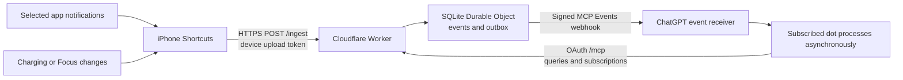

# Architecture

[English](architecture.md) | [简体中文](zh-CN/architecture.md) · [Home](../README.md)

The original architecture record was compiled on 2026-10-02 from the first implementation and phone evidence through 2026-10-01. Documentation changes do not constitute new phone or live-service testing.

DotLink sends owner-selected iPhone events to a connected, subscribed ChatGPT dot. The phone collects; the bridge authenticates, persists, and delivers; the dot interprets. The phone uses system Shortcuts, with no resident custom iOS app or chat-database access.

## Event path

1. iOS provides the trigger input. Notification collection extracts the supplied source, title, and body; state triggers produce their corresponding fields.
2. Shortcuts constructs a dictionary with an event ID, device alias, and timestamp including time zone, then uploads JSON.
3. The Worker validates credentials, device ID, fields, times, and size. It writes the event and matching subscription delivery jobs atomically.
4. Durable Object alarms drive bounded retries. Every outgoing request is signed and checked against subscription expiry, device state, and OAuth authorization.
5. ChatGPT acknowledges the webhook and processes it asynchronously. The consumer's subscription determines the destination dot; a chat-page URL is not a phone upload endpoint.

The referenced iOS 27 documentation describes selecting apps and content filters for Notification triggers, and on/off triggers for Focus. Actual support must be checked on the target phone. [Apple notification triggers](https://support.apple.com/en-ke/guide/shortcuts/apd932ff833f/ios), [setting triggers](https://support.apple.com/en-ke/guide/shortcuts/apde31e9638b/ios).

## Notifications are not a message database

Only content supplied by iOS can be forwarded. If no notification is produced, an app hides the body, or the system provides only a generic notice, the bridge cannot recover the missing text. Historical chats, original audio, original images, and message-retraction state are outside this input's scope.

Messages/SMS has a separate Message trigger. It can use the same upload protocol but needs separate setup and real-message verification. Other apps' successful notifications do not prove SMS support. [Apple communication triggers](https://support.apple.com/en-ke/guide/shortcuts/apdd711f9dff/ios).

A `focus` event reports mode name, enabled/disabled state, and measurement time. It does not control Focus remotely or calculate session duration. This implementation sends no phone-control commands from the dot.

## Three distinct credentials

| Credential | Holder and purpose | Boundary |
| --- | --- | --- |
| Device upload token | Phone sends to `/ingest` | Independent random token; server stores only SHA-256 digest; grants no read access. |
| Bridge OAuth grant | Consumer accesses `/mcp` | Owner, scope, and resource checks; `phone:read` and `phone:subscribe`. |
| Webhook signing key | Bridge and receiver verify delivery | Stored per subscription and sealed with AES-GCM using a Worker Secret; never a phone credential. |

GitHub only verifies the configured owner's numeric ID. No repository permissions are requested and no upstream GitHub access token is persisted. GitHub neither transports nor stores notification bodies. OAuth state uses KV; events, subscriptions, and outbox use a SQLite Durable Object, through [Workers OAuth Provider](https://github.com/cloudflare/workers-oauth-provider) and the [SQLite storage API](https://developers.cloudflare.com/durable-objects/api/sqlite-storage-api/).

This is a single-owner self-hosted model. Multiple device aliases do not imply multi-tenant isolation or implemented collectors for other platforms.

DotLink includes a bilingual `/setup` guide. Its Web Crypto credential generation stays in the browser; the user applies values in Cloudflare. It does not accept cloud administration credentials, manage existing devices, or rotate existing subscription keys. See [deployment](deployment.md).

## Four meanings of success

| Checkpoint | Proves | Does not prove |
| --- | --- | --- |
| Actual Shortcuts trigger | A system event started collection | Upload success or long-term background reliability |
| `/ingest` `202`, `accepted:true` | Event accepted and persisted | dot receipt or understanding |
| Webhook `2xx` | Receiver acknowledged delivery | Per-event dot processing or action |
| dot response matches ID and fields | This event entered the target dot's processing path | Reliability for all sources and states |

[MCP Events](https://developers.openai.com/plugins/build/mcp-events) distinguishes receiver acknowledgement from asynchronous processing and provides renewal and optional replay mechanisms.

The 24-hour default and maximum subscription lifetime are implementation choices. Refreshing the same subscription identity updates `refreshBefore`; automatic cross-day renewal still lacks historical real-phone acceptance evidence. This implementation returns `cursor:null` and rejects nonempty cursors.

## Reliability and retention

- The bridge outbox covers only successfully uploaded events matching an active subscription at receipt. There is no persistent phone outbox to recover events never uploaded.
- Uploads without an active subscription can be stored, but later subscription does not automatically deliver them. Authorized consumers can page through retained data using `phone_events`.
- Retry the same event ID and content. Same device/ID/content deduplicates; changed content conflicts. Delivery may be duplicated or out of order; consumers must remain idempotent.
- Events expire seven days after occurrence; reads exclude expired data. Platform backups and consumer conversation/memory copies have separate retention rules.
- HTTPS protects transport. Server-readable notification JSON is stored in the business database; this is not end-to-end encryption between only phone and dot.
- Callbacks are restricted to validated OpenAI/ChatGPT domains over HTTPS with no redirect following. Notification bodies are untrusted third-party data, not higher-priority instructions.

Phone upload and cloud callback are separate network hops. A reachable bridge does not establish availability for every region, network, account, or platform service.

## Source map

| File | Responsibility |
| --- | --- |
| `src/http.mjs`, `src/access.mjs` | HTTP routing, device authentication, owner authorization |
| `src/auth.mjs`, `src/oauth-options.mjs` | Identity, OAuth, resource configuration |
| `src/protocol.mjs` | Fields, times, sizes, callback validation, signature utilities |
| `src/store.mjs`, `src/bridge.mjs` | SQLite transactions, queries, subscriptions, outbox, alarms |
| `src/subscriptions.mjs`, `src/mcp.mjs` | MCP tools, subscription identity, signed challenge, delivery |
| `src/app-usage.mjs` | Estimates from already-uploaded app open/close observations |

Continue with the [first version](first-version.md), [FAQ](faq.md), and [roadmap](roadmap.md).
