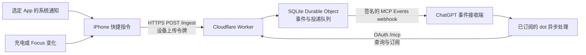

# 架构与技术原理

[English](../architecture.md) | [简体中文](architecture.md) · [首页](../../README.zh-CN.md)

资料整理日期：2026-10-02。本文描述第一版源码及截至 2026-10-01 的历史实机验证边界，不代表在整理文档时重新测试了手机或线上服务。

这个项目把用户主动选择的 iPhone 事件交给已经连接并订阅的 ChatGPT dot。手机负责采集，Bridge 负责鉴权、持久化和投递，dot 负责理解事件。第一版手机端使用系统快捷指令，没有常驻的自研 iOS App，也不读取聊天数据库。

## 数据如何到达 dot

1. iOS 向快捷指令交付触发事件。通知流程取来源 App、标题和正文；状态流程产生对应字段。
2. 快捷指令将字段放进字典，生成事件 ID、设备别名和带时区的时间，再以 JSON 上传。
3. Worker 验证设备令牌、设备 ID、字段、时间及大小，将事件和匹配订阅的投递任务写入同一事务。
4. Durable Object 的 alarm 驱动有限次数的重试；每次外发都签名，并检查订阅有效期、设备状态和 OAuth 授权。
5. ChatGPT 接收 webhook 后异步处理。事件能进入哪个 dot，取决于该消费者建立的订阅，而不是手机填写一个聊天页面地址。

Apple 的 iOS 27 文档明确提供 Notification trigger，可选择 App 和内容筛选条件；Focus 则有开启、关闭触发器。[通知触发器](https://support.apple.com/en-ke/guide/shortcuts/apd932ff833f/ios)、[设置触发器](https://support.apple.com/en-ke/guide/shortcuts/apde31e9638b/ios)

## 通知不等于消息数据库

通知入口只能转发 iOS 实际交付的内容。App 没有产生通知、正文被源 App 隐藏，或系统只交付通用提示时，Bridge 无法补出缺失正文。历史聊天、原始语音、图片原图和撤回状态不在这个入口的能力范围内。

运营商 SMS／Messages 有独立的 Message trigger。它可以复用相同上传协议，但需要单独配置和真实短信验证；已有其他 App 通知通过，不能当作 SMS 已通过。[Apple Communication triggers](https://support.apple.com/en-ke/guide/shortcuts/apdd711f9dff/ios)

`focus` 事件报告模式名称、开启／关闭及测量时间。它不是远程控制勿扰模式的接口；第一版没有从 dot 下发手机控制命令，也不计算 Focus 使用时长。

## 三组不同的权限

| 权限 | 持有者与用途 | 第一版边界 |
| --- | --- | --- |
| 设备上传令牌 | 手机向 `/ingest` 上传 | 独立随机令牌，服务端只登记 SHA-256 摘要；不能读取数据 |
| Bridge OAuth 授权 | 消费者访问 `/mcp` | 校验 owner、scope 和资源；读取与订阅使用 `phone:read`、`phone:subscribe` |
| webhook 签名密钥 | Bridge 与事件接收端验证投递 | 随订阅保存，以 Worker Secret 中的密钥进行 AES-GCM 封装；不作为手机凭据 |

GitHub 只提供 owner 的身份验证，第一版固定为一个允许的 GitHub 数字 ID，不申请仓库权限，也不持久化 GitHub 上游访问令牌。GitHub 不承担通知运输或存储。OAuth 状态使用 KV；业务事件、订阅和 outbox 使用 SQLite Durable Object。实现采用官方 [Workers OAuth Provider](https://github.com/cloudflare/workers-oauth-provider) 和 [SQLite storage API](https://developers.cloudflare.com/durable-objects/api/sqlite-storage-api/)。

当前是单 owner、自托管的部署模型，不是多租户服务。设备登记允许多个设备别名，只说明协议具备这种表达能力，不代表其他平台采集器已经实现。

DotLink 提供双语 `/setup` 指南。凭据由浏览器 Web Crypto 本地生成，再由本人填入 Cloudflare；向导不接收云端管理凭据，不管理现有设备，也不轮换既有订阅密钥。见[部署指南](deployment.md)。

## 四层成功含义

| 层次 | 可以证明 | 不能证明 |
| --- | --- | --- |
| 快捷指令真实触发 | 某个系统事件确实启动了采集流程 | 上传成功或后台长期可靠 |
| `/ingest` 返回 `202` 与 `accepted:true` | Bridge 已接受并持久化该事件 | dot 已收到或理解 |
| webhook 返回 `2xx` | 接收端确认收到投递 | dot 已逐条处理或采取行动 |
| dot 回执与事件 ID、字段相符 | 该事件已进入目标 dot 的实际处理路径 | 全部来源、所有状态都可靠 |

MCP Events 官方明确区分 webhook 收件确认和异步处理；它还支持订阅续期与可选重放。[OpenAI MCP Events](https://developers.openai.com/plugins/build/mcp-events)

第一版把订阅默认及最长寿命设为 24 小时，这是代码选择，不是协议限制。相同订阅身份可以续订并获得新的 `refreshBefore`，但跨日自动续订尚未获得历史实机验收。当前返回 `cursor:null`，拒绝非空游标，没有实现协议重放。

## 可靠性和保留边界

- Bridge outbox 只保护已经上传成功、且当时匹配有效订阅的事件。手机没有持久 outbox，断网时未上传的通知目前无法保证补传。
- 没有有效订阅期间仍可保存上传事件，但之后建立订阅不会自动补发旧事件。消费者可以在保留期内通过 `phone_events` 分页恢复读取。
- 重试复用同一事件 ID；相同设备、相同 ID、相同内容去重，相同 ID 不同内容拒绝。投递可能重复或乱序，消费者仍需幂等处理。
- 应用层按事件发生时间七天过期，读取会排除过期记录。平台备份及消费者保存的对话／记忆有各自保留规则，Bridge 删除不等于删除这些副本。
- HTTPS 保护传输；通知正文以可供服务端处理的形式存入业务数据库。这不是只有手机和 dot 能解密的端到端加密系统。
- 当前回调仅允许指定 OpenAI／ChatGPT 域名、HTTPS 和非重定向请求。正文属于第三方输入，消费者应把它作为数据，而不是新的高权限指令。

手机上传和 Bridge 外发是两段独立网络连接。手机只需访问自己的 Bridge 入口，不能据此保证某个地区、运营商或账户一定可用；连通性与平台服务可用性需要分别验证。

## 源码入口

| 文件 | 职责 |
| --- | --- |
| `src/http.mjs`、`src/access.mjs` | HTTP 入口、设备鉴权、owner 权限 |
| `src/auth.mjs`、`src/oauth-options.mjs` | 身份验证、OAuth 与资源配置 |
| `src/protocol.mjs` | 字段、时间、大小及回调验证；签名工具 |
| `src/store.mjs`、`src/bridge.mjs` | SQLite 事务、查询、订阅、outbox 和 alarm |
| `src/subscriptions.mjs`、`src/mcp.mjs` | MCP 工具、订阅身份、签名 challenge、事件投递 |
| `src/app-usage.mjs` | 根据已上传开／关观测估算 App 使用时间 |

下一步阅读：[第一版实现](first-version.md)、[网络、身份与续期常见问题](faq.md)和[后续路线](roadmap.md)。
